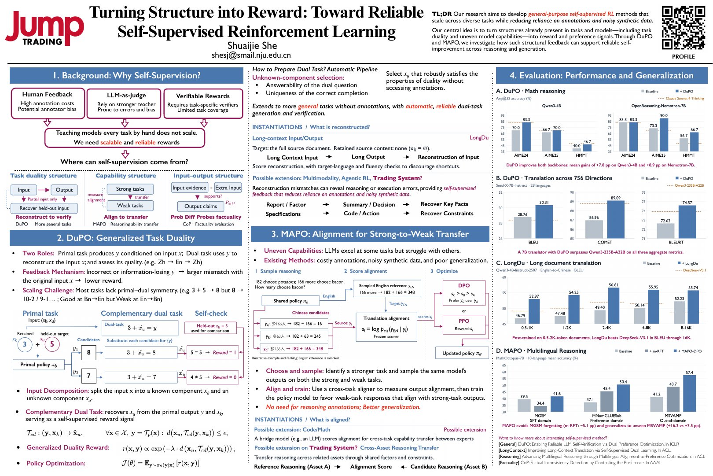

I shared an overview of our work on general-purpose self-supervised reinforcement learning at the Jump Trading AI Workshop in Hong Kong.

The presentation connects three sources of feedback already present in tasks and models: task duality, uneven capabilities across related tasks, and input-output structure. It discusses how DuPO, MAPO, and related methods turn these structures into reward or preference signals for self-verification, strong-to-weak transfer, and reliable improvement without relying on dense human annotations.

The poster is embedded below; it is also available as a <a class="btn btn--inverse btn--small" href="/files/ShuaijieShe_JumpTrading_AI_Poster.pdf"><i class="fa fa-fw fa-download" aria-hidden="true"></i> PDF download</a>.

  <iframe class="poster-embed__pdf" src="/files/ShuaijieShe_JumpTrading_AI_Poster.pdf" title="Poster: Turning Structure into Reward (PDF)"></iframe>
  

